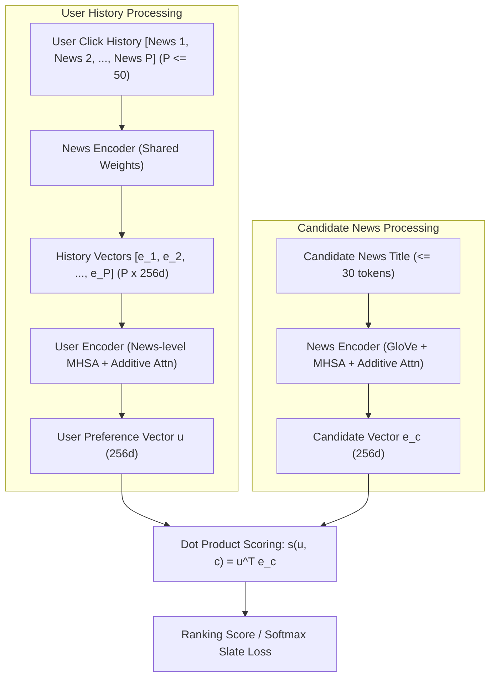
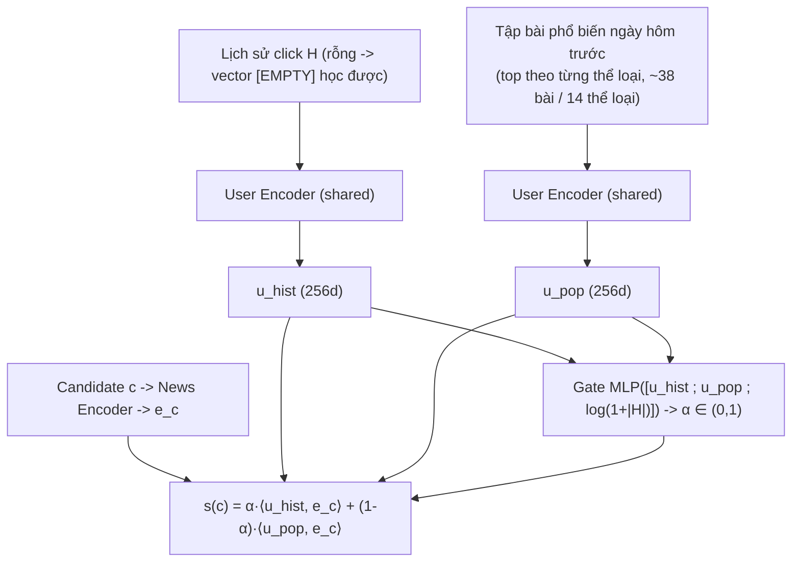
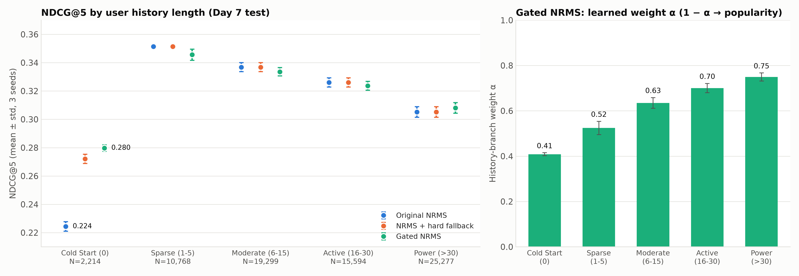

# Kiến Trúc NRMS (Neural News Recommendation with Multi-Head Self-Attention)
## BT4222 Mining Web Data for Business Insights — Group 12
### Mô hình đề xuất tin tức phục vụ bài toán Homepage Spotlight Slate Optimisation trên MIND-small

---

## 1. Đặt vấn đề & Lý do lựa chọn kiến trúc NRMS

Trong bài toán tối ưu hóa danh sách bài báo nổi bật trên trang chủ (Homepage Spotlight Slate Rotation), các hệ thống đề xuất gặp phải ba thách thức cốt lõi:
1. **Vòng đời tin tức cực ngắn (High Item Churn & Cold-Start)**: Tin tức mới liên tục được xuất bản mỗi giờ, trong khi các tin cũ nhanh chóng mất đi tính thời sự. Các mô hình Collaborative Filtering truyền thống (như NCF, Matrix Factorization) phụ thuộc hoàn toàn vào `item_id` sẽ thất bại trước các bài báo mới (chưa từng có tương tác trong quá khứ).
2. **Tiêu đề tin tức ngắn nhưng giàu ngữ nghĩa**: Tiêu đề báo chí cô đọng, trong đó sự tương tác ngữ cảnh giữa các từ (ví dụ: *"Trump"*, *"Aid Freeze"*, *"Ukraine"*) quyết định chủ đề cốt lõi hơn là từng từ đứng riêng lẻ.
3. **Sở thích người dùng đa dạng và biến đổi**: Một người dùng có thể đồng thời quan tâm đến nhiều chủ đề khác nhau (ví dụ: vừa đọc tin tài chính, vừa đọc thể thao), đòi hỏi mô hình phải học được mối liên hệ giữa các bài báo trong lịch sử đọc.

**NRMS (Neural News Recommendation with Multi-Head Self-Attention - Wu et al., EMNLP 2019)** được lựa chọn làm mô hình cốt lõi vì:
- **Biểu diễn nội dung ngữ nghĩa thuần túy (Content-based Semantic Representation)**: Biểu diễn bài báo được học từ tiêu đề thông qua GloVe pre-trained embeddings kết hợp cơ chế Self-Attention đa đầu. Bài báo mới xuất bản (brand-new article) có thể được nhúng ngay lập tức vào không gian vector 256 chiều mà không cần chờ tương tác người dùng.
- **Tuân thủ góp ý của giảng viên (`advise.md`)**:
  - Không sử dụng `slate_length` làm predictive feature (tránh logging selection artifact).
  - Không phụ thuộc vào proxy `article_recency` suy diễn từ log hiển thị đầu tiên (tránh méo mó biên ngày Day 1).
  - Không cần biến `inactivity_gap` (vốn bị missing 41%), mô hình mã hóa chuỗi đọc lịch sử trực tiếp thông qua Attention.
  - Điểm phù hợp được tính bằng tích vô hướng (Dot Product) cá nhân hóa, tối ưu hóa trực tiếp cho việc xếp hạng Top-$K$ trên slate.

Ngoài NRMS gốc, nhóm đề xuất và đánh giá biến thể **Gated Two-Branch NRMS** (Mục 3.4, 6.6): bổ sung một nhánh phổ biến (popularity branch) và một cổng học được (learned gate) để xử lý người dùng mới không có lịch sử đọc.

---

## 2. Sơ đồ kiến trúc tổng thể (Architecture Diagrams)

### 2.1. Sơ đồ luồng dữ liệu cấp cao — NRMS gốc



### 2.2. Sơ đồ Gated Two-Branch NRMS (đề xuất)



### 2.3. Chi tiết cấu trúc News Encoder và User Encoder

```text
========================================================================================
                                     NEWS ENCODER
========================================================================================
 News Title:   [ "NVIDIA",      "announces",      "new",       "AI",       "chips" ]
                   │                 │              │           │             │
                   ▼                 ▼              ▼           ▼             ▼
 Word Embed:   [  300d  ]       [  300d  ]     [  300d  ]  [  300d  ]    [  300d  ]  (GloVe)
                   │                 │              │           │             │
 Linear Proj:  [  256d  ]       [  256d  ]     [  256d  ]  [  256d  ]    [  256d  ]
                   └─────────────────┬──────────────┴───────────┴─────────────┘
                                     ▼
                    Multi-Head Word Self-Attention (16 Heads)
                     - Học tương tác ngữ cảnh giữa các từ
                     - Output: Chuỗi vector từ ngữ cảnh hóa [L x 256d]
                                     │
                                     ▼
                      Additive Word Attention (Attention Pooling)
                     - Học trọng số chú ý alpha_i = Softmax(q_w^T tanh(W_w h_i + b_w))
                     - Lọc bỏ stopwords, nhấn mạnh từ khóa mang tính thông tin
                                     │
                                     ▼
                       News Vector: e_n in R^(256)
========================================================================================

========================================================================================
                                     USER ENCODER
========================================================================================
 Clicked News: [ News 1 ]       [ News 2 ]     [ News 3 ]  ...  [ News P ] (P <= 50)
                   │                 │              │               │
 Shared NE:    [  256d  ]       [  256d  ]     [  256d  ]       [  256d  ]
                   └─────────────────┬──────────────┴───────────────┘
                                     ▼
                    Multi-Head News Self-Attention (16 Heads)
                     - Học mối liên hệ giữa các bài báo đã đọc
                                     │
                                     ▼
                      Additive News Attention (Attention Pooling)
                     - Học trọng số chú ý beta_i = Softmax(q_u^T tanh(W_u z_i + b_u))
                                     │
                                     ▼
                       User Vector: u in R^(256)
========================================================================================
```

---

## 3. Công thức toán học & Chi tiết kỹ thuật từng tầng

### 3.1. News Encoder (Bộ mã hóa tin tức)

News Encoder nhận đầu vào là tiêu đề bài báo gồm chuỗi $M$ từ $[w_1, w_2, \dots, w_M]$ ($M \le 30$).

#### Bước 1: Word Embedding & Projection
Mỗi từ $w_i$ được ánh xạ thành vector embedding 300 chiều thông qua ma trận GloVe được khởi tạo sẵn:
$$x_i^{(0)} = \operatorname{Embedding}(w_i) \in \mathbb{R}^{300}$$
Sau đó, một tầng Linear chiếu vector về không gian làm việc của mô hình:
$$x_i = W_p x_i^{(0)} + b_p \in \mathbb{R}^{256}$$

#### Bước 2: Word-Level Multi-Head Self-Attention
Với head thứ $k$ ($k = 1, \dots, 16$):
$$Q^k = X W_Q^k, \quad K^k = X W_K^k, \quad V^k = X W_V^k$$
Trong đó $d_k = 16$ ($16 \text{ heads} \times 16 \text{ dim} = 256$). Trọng số chú ý giữa từ thứ $i$ và từ thứ $j$:
$$a_{i,j}^k = \frac{\exp\left(\frac{(Q_i^k)^T K_j^k}{\sqrt{d_k}}\right)}{\sum_{m=1}^M \exp\left(\frac{(Q_i^k)^T K_m^k}{\sqrt{d_k}}\right)}$$
$$h_i^k = \sum_{j=1}^M a_{i,j}^k V_j^k, \qquad h_i = [h_i^1 ; h_i^2 ; \dots ; h_i^{16}] \in \mathbb{R}^{256}$$

#### Bước 3: Additive Word Attention (Attention Pooling)
$$a_i = q_w^T \tanh(W_w h_i + b_w), \qquad \alpha_i = \frac{\exp(a_i)}{\sum_{j=1}^M \exp(a_j)}$$
Trong đó $W_w \in \mathbb{R}^{200 \times 256}$, $b_w \in \mathbb{R}^{200}$, $q_w \in \mathbb{R}^{200}$. Vector biểu diễn bài báo:
$$e_n = \sum_{i=1}^M \alpha_i h_i \in \mathbb{R}^{256}$$

---

### 3.2. User Encoder (Bộ mã hóa người dùng)

User Encoder nhận đầu vào là lịch sử đọc gồm $P$ bài báo đã click $[d_1, d_2, \dots, d_P]$ ($P \le 50$).

1. **Shared News Representation**: $E_H = [e_1, \dots, e_P] \in \mathbb{R}^{P \times 256}$ (dùng chung News Encoder ở 3.1).
2. **News-Level Multi-Head Self-Attention**: $Z = \operatorname{MultiHeadAttention}(E_H, E_H, E_H) \in \mathbb{R}^{P \times 256}$ (16 heads).
3. **Additive News Attention**:
$$a_i^u = q_u^T \tanh(W_u z_i + b_u), \qquad \beta_i = \frac{\exp(a_i^u)}{\sum_{j=1}^P \exp(a_j^u)}, \qquad u = \sum_{i=1}^P \beta_i z_i \in \mathbb{R}^{256}$$

#### Điểm yếu cấu trúc với Cold-Start User
Khi người dùng không có lịch sử ($P = 0$, chiếm **3.0%** impression của tập test và **1.91%** mẫu huấn luyện), toàn bộ đầu vào bị mask nên $u = \vec{0}$ và mọi ứng viên đều có điểm $u^\top e_c = 0$. Hệ quả:
- **Khi suy luận**: mô hình không có thông tin để xếp hạng — kết quả tương đương xếp hạng ngẫu nhiên (AUC = 0.5).
- **Khi huấn luyện**: loss của các mẫu này là hằng số $\log 5$ và gradient bằng 0 — mô hình **không học được gì** từ nhóm người dùng này.

Hai vấn đề này là động lực cho kiến trúc Gated Two-Branch NRMS (Mục 3.4).

---

### 3.3. Click Predictor & Hàm mất mát huấn luyện

#### Điểm dự đoán Click (Ranking Score)
$$s(u, c) = u^T e_c$$
Tích vô hướng có chi phí $O(D)$, cho phép xếp hạng hàng chục ngàn candidate articles rất nhanh.

#### Impression-Constrained Negative Sampling & Softmax Loss
- Với mỗi bài báo được click ($c^+$) trong một impression, lấy mẫu ngẫu nhiên 4 bài không được click ($c_1^-, \dots, c_4^-$) **từ chính impression đó** (không lấy từ bài chưa được hiển thị).
- Hàm mất mát là **softmax cross-entropy (sampled softmax)** trên 5 ứng viên — *không phải* Binary Cross-Entropy:
$$\mathcal{L}_{CE} = - \sum_{i=1}^{N} \log p_i^+, \qquad p_i^+ = \frac{\exp(s(u_i, c_i^+))}{\exp(s(u_i, c_i^+)) + \sum_{j=1}^4 \exp(s(u_i, c_{i, j}^-))}$$

#### Biến thể thử nghiệm: Focal Loss
Viết lại cho dạng softmax trên 1+K ứng viên, giảm trọng số các impression "dễ":
$$\mathcal{L}_{focal} = - \sum_{i=1}^{N} (1 - p_i^+)^{\gamma} \log p_i^+, \qquad \gamma = 2$$

---

### 3.4. Gated Two-Branch NRMS (Kiến trúc đề xuất)

Thay vì công tắc cứng "nếu không có lịch sử thì dùng vector phổ biến" áp dụng *sau khi* huấn luyện, hai nhánh được **huấn luyện end-to-end** và trộn bằng một trọng số học được cho từng người dùng.

1. **Nhánh lịch sử (History branch)**: $u_{hist} = \text{UserEncoder}(H)$. Nếu $H = \emptyset$, lịch sử được thay bằng một **vector `[EMPTY]` học được** $e_{\varnothing} \in \mathbb{R}^{256}$, nên $u_{hist} = \text{UserEncoder}([e_{\varnothing}]) \neq \vec{0}$ và mẫu cold-start có gradient khi huấn luyện.

2. **Nhánh phổ biến (Popularity branch)**: với impression ở ngày $d$, tập phổ biến $\mathcal{P}_d$ được lấy từ **lượt click của ngày $d-1$** (không rò rỉ thông tin cùng ngày; Day 1 không có ngày trước nên dùng click của chính nó), **phân tầng theo thể loại**:
   - mỗi thể loại có $\ge 20$ click/ngày đóng góp top-2 bài nhiều click nhất;
   - thêm 10 suất được chia theo tỷ lệ lượt click của thể loại (largest remainder).
   - Kết quả thực tế: **38 bài trên 14 thể loại mỗi ngày** (ví dụ ngày 15/11: news 5, lifestyle 4, sports/finance/music/foodanddrink/health 3, các thể loại còn lại 2).
   $$u_{pop, d} = \text{UserEncoder}(\{e_p : p \in \mathcal{P}_d\})$$
   $u_{pop}$ được tính lại trong mỗi batch bằng chính User Encoder đang huấn luyện.

3. **Cổng học được (Learned gate)** — không có ngưỡng đặt tay:
   $$\alpha = \sigma\Big(\text{MLP}\big([u_{hist} ; u_{pop} ; \tfrac{\log(1+|H|)}{\log 51}]\big)\Big) \in (0, 1), \qquad \text{MLP}: 513 \to 128 \to 1$$

4. **Điểm xếp hạng** — trộn đóng góp của hai nhánh:
   $$s(c) = \alpha \langle u_{hist}, e_c \rangle + (1-\alpha) \langle u_{pop}, e_c \rangle = \langle \alpha u_{hist} + (1-\alpha) u_{pop},\ e_c \rangle$$
   Đẳng thức bên phải cho phép suy luận nhanh như NRMS gốc (một vector người dùng hiệu dụng).

5. **History dropout (chỉ khi huấn luyện)**: vì chỉ 1.91% mẫu huấn luyện có lịch sử rỗng, mỗi mẫu có xác suất 10% bị xóa toàn bộ lịch sử và 10% bị cắt còn 1–3 click cuối, để cổng thấy đủ trường hợp cold-start/sparse.

---

## 4. Kỹ thuật tăng tốc & Tối ưu hóa tính toán (Engineering Highlights)

### 4.1. Unique News ID Batch Indexing
- *Vấn đề*: Mỗi batch gồm 128 người dùng × (50 bài lịch sử + 5 candidate) $= 7{,}040$ tiêu đề, phần lớn bị lặp lại hoặc là padding.
- *Giải pháp*: gom các bài trùng lặp bằng `torch.unique` và chỉ encode mỗi bài một lần, sau đó phân phối lại qua `inverse_indices`. Với Gated NRMS, tập phổ biến (7 ngày × 38 bài) cũng được gộp vào cùng một lần encode.
- *Hiệu quả*: mỗi epoch 189,519 mẫu mất **~3.5 phút** (NRMS gốc ~215 s, Gated ~205 s) trên GPU RTX 4050 Laptop 6GB.

### 4.2. Vectorized Pre-Encoding Inference
1. Forward toàn bộ **65,238 bài báo** qua `NewsEncoder` đúng một lần để tạo ma trận lookup `news_vecs` kích thước `[65239, 256]`.
2. Batch forward lịch sử người dùng để tạo `user_vecs` `[N, 256]` (với Gated NRMS là vector hiệu dụng $\alpha u_{hist} + (1-\alpha) u_{pop}$).
3. Tính điểm candidates bằng `torch.mv`.
- *Hiệu quả*: đánh giá toàn bộ **73,152 impression** của Test set (bao gồm tính AUC/MRR/NDCG cho từng impression) mất **~18 giây**.

### 4.3. Xử lý điểm hòa (tie) khi đánh giá
Khi nhiều ứng viên có cùng điểm (đặc biệt NRMS gốc với cold-start user: mọi điểm = 0), việc dùng `argsort` sẽ xếp hạng theo **thứ tự hiển thị trong log** — một artifact vị trí, không phản ánh năng lực mô hình. Pipeline đánh giá xử lý như sau:
- AUC dùng **hạng trung bình** cho các điểm hòa (điểm hòa hoàn toàn cho AUC = 0.5 chính xác);
- MRR/NDCG **phá hòa ngẫu nhiên** (seed cố định, tái lập được).

---

## 5. Tổng hợp thông số siêu tham số (Hyperparameter Table)

| Siêu tham số | Giá trị | Giải thích |
|---|:---:|---|
| **Word Embedding** | GloVe 6B 300d | Độ phủ từ vựng **96.83%** (20,674 / 21,351 từ, min_freq ≥ 2). |
| **News / User Representation Dimension** | **256** | Cấu hình của Wu et al. (2019): 16 heads × 16 chiều/head. |
| **Number of Attention Heads** | **16** | |
| **Additive Attention Query Dimension** | **200** | |
| **Negative Sampling Ratio** | **4** | 1 click : 4 không click trong cùng impression. |
| **Max Title Length / Max History Length** | **30 tokens / 50 bài** | |
| **Dropout** | **0.2** | Sau embedding và attention. |
| **Batch Size** | **128** | |
| **Optimizer & Learning Rate** | Adam, $10^{-4}$ | |
| **Epochs & Model Selection** | **3 epoch**, chọn checkpoint có NDCG@5 Validation cao nhất | Áp dụng giống nhau cho mọi seed, mọi biến thể và ablation. Val NDCG@5 phần lớn vẫn đang tăng ở epoch 3 → mô hình có thể chưa hội tụ hẳn. |
| **Gate MLP (Gated NRMS)** | 513 → 128 → 1, sigmoid | Đầu vào: $u_{hist}$, $u_{pop}$, độ dài lịch sử chuẩn hóa log. |
| **Popular set (Gated NRMS)** | 2 bài/thể loại + 10 suất theo tỷ lệ, thể loại ≥ 20 click | Lấy từ click của ngày hôm trước. |
| **History dropout (Gated NRMS)** | xóa 10%, cắt còn 1–3 bài 10% | Chỉ khi huấn luyện. |

---

## 6. Kết quả thực nghiệm & Bằng chứng định lượng

Huấn luyện trên **Train (Days 1–5: 126,695 impressions → 189,519 mẫu)**, chọn mô hình trên **Validation (Day 6: 30,270 impressions)**, đánh giá trên **Test (Day 7: 73,152 impressions)**. Mọi con số dưới đây được tái tạo bởi:
- `models/train_and_evaluate.py` (log trong `models/logs/{nrms,gated,gated_nodrop,gated_focal}.log`);
- `models/evaluate_seeds.py` (so sánh 3 seed và kiểm định thống kê, log trong `models/logs/seed_comparison.log`, kết quả trong `models/figures/seed_comparison_summary.json`).

### 6.1. Benchmark chính trên Test Set (Day 7)
| Mô hình | AUC | MRR | NDCG@5 | NDCG@10 |
|---|:---:|:---:|:---:|:---:|
| Microsoft Recommenders NRMS (số công bố) | 0.6127 | 0.2697 | 0.2912 | 0.3625 |
| **NRMS (nhóm 12), seed 42** | **0.6373** | **0.3410** | **0.3252** | **0.3891** |

*Lưu ý*: baseline của Microsoft được huấn luyện trên toàn bộ tập train (Days 1–6) với cấu hình riêng; nhóm chỉ dùng Days 1–5 để huấn luyện và giữ Day 6 làm Validation. Hai con số cùng đánh giá trên Day 7 nhưng khác quy trình, nên chỉ mang tính tham khảo.

- **MRR = 0.341**: thứ hạng nghịch đảo trung bình của bài được click đầu tiên tương ứng khoảng vị trí 2.9 trong slate (~37 ứng viên/impression).

### 6.2. Độ bền vững đa seed (Mean ± Std, 3 seed, cùng 3 epoch và cùng cách chọn checkpoint)
| Mô hình | Seed 42 NDCG@5 | Seed 43 NDCG@5 | Seed 44 NDCG@5 | AUC | MRR | NDCG@5 | NDCG@10 |
|---|:---:|:---:|:---:|:---:|:---:|:---:|:---:|
| NRMS gốc | 0.3252 | 0.3182 | 0.3236 | 0.6327 ± 0.0039 | 0.3394 ± 0.0026 | 0.3223 ± 0.0030 | 0.3853 ± 0.0032 |
| NRMS + hard fallback | 0.3267 | 0.3195 | 0.3252 | 0.6343 ± 0.0041 | 0.3407 ± 0.0026 | 0.3238 ± 0.0031 | 0.3865 ± 0.0034 |
| **Gated NRMS** | 0.3189 | 0.3226 | 0.3269 | 0.6327 ± 0.0032 | 0.3391 ± 0.0028 | 0.3228 ± 0.0033 | 0.3853 ± 0.0029 |

$\implies$ Độ lệch chuẩn giữa các seed ≈ 0.003–0.004. Đây là "biên nhiễu" cần vượt qua trước khi khẳng định một biến thể tốt hơn biến thể khác.

### 6.3. Phân khúc theo độ dài lịch sử (Mean ± Std qua 3 seed)
| Phân khúc | N | NRMS gốc AUC | NRMS gốc NDCG@5 | Gated AUC | Gated NDCG@5 | α của Gated |
|---|:---:|:---:|:---:|:---:|:---:|:---:|
| **Cold Start (0)** | 2,214 (3.0%) | 0.5000 ± 0.0000 | 0.2243 ± 0.0034 | **0.5590 ± 0.0061** | **0.2797 ± 0.0022** | 0.41 ± 0.01 |
| **Sparse (1–5)** | 10,768 (14.7%) | 0.6081 ± 0.0027 | **0.3514 ± 0.0016** | 0.6031 ± 0.0030 | 0.3456 ± 0.0040 | 0.52 ± 0.03 |
| **Moderate (6–15)** | 19,299 (26.4%) | 0.6312 ± 0.0033 | 0.3368 ± 0.0031 | 0.6277 ± 0.0025 | 0.3336 ± 0.0030 | 0.63 ± 0.02 |
| **Active (16–30)** | 15,594 (21.3%) | 0.6474 ± 0.0047 | 0.3260 ± 0.0032 | 0.6446 ± 0.0029 | 0.3236 ± 0.0032 | 0.70 ± 0.02 |
| **Power (>30)** | 25,277 (34.6%) | 0.6468 ± 0.0049 | 0.3052 ± 0.0038 | 0.6484 ± 0.0040 | 0.3081 ± 0.0038 | 0.75 ± 0.02 |



$\implies$ Với NRMS gốc, nhóm Cold-Start có AUC = 0.5 đúng bằng ngẫu nhiên (xem 3.2). Chỉ cần 1–5 click, AUC tăng lên 0.608. Lưu ý NDCG@5 *giảm dần* khi lịch sử dài hơn trong khi AUC tăng, do slate của người dùng nhiều lịch sử thường dài hơn.

### 6.4. Độ ổn định theo giờ trong ngày (Diurnal Analysis, NRMS gốc seed 42)
- **NDCG@5** theo 24 khung giờ của Day 7: dao động trong `[0.2793, 0.4028]`, $\sigma = 0.034$.
- **AUC**: dao động trong `[0.6007, 0.6871]`, $\sigma = 0.025$.

$\implies$ Hiệu năng **thay đổi đáng kể theo giờ** (NDCG@5 chênh tới ~0.12 giữa giờ tốt nhất và tệ nhất), nên **không thể** kết luận mô hình "bất biến theo chu kỳ ngày đêm". Một phần biến động đến từ khác biệt về số lượng và độ dài slate giữa các giờ. Hình: `models/figures/temporal_hourly_analysis.png`.

### 6.5. Nghiên cứu thành phần (Self-Attention Ablation, seed 42, cùng 3 epoch và cùng cách chọn checkpoint)
| Biến thể | AUC | MRR | NDCG@5 | NDCG@10 | Thời gian/epoch |
|---|:---:|:---:|:---:|:---:|:---:|
| NRMS đầy đủ (MHSA) | 0.6373 | 0.3413 | 0.3255 | 0.3894 | ~215 s |
| NRMS **không** MHSA | 0.6384 | 0.3479 | 0.3307 | 0.3920 | ~42 s |
| Gated NRMS đầy đủ | 0.6304 | 0.3357 | 0.3189 | 0.3825 | ~205 s |
| Gated NRMS **không** MHSA | **0.6411** | **0.3524** | **0.3348** | **0.3965** | ~41 s |

$\implies$ Khi huấn luyện công bằng (cùng số epoch, cùng chọn checkpoint), **bỏ Multi-Head Self-Attention không làm giảm, thậm chí tăng nhẹ hiệu năng, và nhanh hơn ~5 lần**. Kết quả trong bản trước của tài liệu này (MHSA đóng góp +1%) là do bản ablation chỉ được huấn luyện 2 epoch và không chọn checkpoint tốt nhất. Giả thuyết: MHSA trong cài đặt này không có residual / LayerNorm / positional encoding và chỉ được huấn luyện 3 epoch với lr $10^{-4}$, nên chưa khai thác được lợi thế. Đây mới là kết quả 1 seed — cần lặp lại với nhiều seed trước khi thay đổi kiến trúc chính.

### 6.6. Gated Two-Branch NRMS — Kết quả và kiểm định thống kê

#### So sánh trên 3 seed
Kiểm định được thực hiện trên **điểm từng impression đã lấy trung bình qua 3 seed**: khoảng tin cậy 95% bootstrap (2,000 lần) của chênh lệch trung bình, kiểm định Wilcoxon signed-rank, và dấu của chênh lệch trong từng seed. Một khác biệt chỉ được coi là **vững** khi khoảng tin cậy không chứa 0 **và** cả 3 seed cùng dấu.

| So sánh (B − A) | Nhóm | ΔAUC | ΔNDCG@5 [95% CI] | Dấu theo seed (NDCG@5) | Kết luận |
|---|---|:---:|:---:|:---:|---|
| Gated − NRMS gốc | **Cold Start** | **+0.0590** | **+0.0554** [+0.044, +0.067] | + + + | **Cải thiện vững** (NDCG@5 +24.7%) |
| Hard fallback − NRMS gốc | Cold Start | +0.0530 | +0.0477 [+0.037, +0.059] | + + + | Cải thiện vững (NDCG@5 +21.3%) |
| Gated − Hard fallback | Cold Start | +0.0060 | +0.0077 [+0.002, +0.013] | + + + | Gated nhỉnh hơn, nhỏ nhưng nhất quán (+2.8%) |
| Gated − NRMS gốc | Có lịch sử (≥1) | −0.0018 | −0.0013 [−0.002, −0.001] | − + + | Thiệt nhẹ, không nhất quán giữa các seed |
| Gated − NRMS gốc | **Toàn bộ** | +0.0001 | +0.0005 [−0.000, +0.001] | − + + | **Không khác biệt** |
| Hard fallback − NRMS gốc | Toàn bộ | +0.0016 | +0.0014 [+0.001, +0.002] | + + + | Cải thiện nhỏ, vững (chỉ tác động lên cold-start) |

Chi tiết đầy đủ cho cả 4 metric và p-value: `models/logs/seed_comparison.log`.

#### Diễn giải
1. **Nhánh phổ biến giải quyết được Cold-Start.** Cả hai cách tích hợp (công tắc cứng và cổng học được) đều đưa nhóm người dùng mới từ mức ngẫu nhiên (AUC 0.50) lên AUC ~0.56 và tăng NDCG@5 hơn 20%, nhất quán trên cả 3 seed.
2. **Cổng học được hành vi hợp lý và có thể diễn giải.** Trọng số nhánh lịch sử $\alpha$ tăng đơn điệu theo độ dài lịch sử: **0.41 → 0.52 → 0.63 → 0.70 → 0.75**, rất ổn định giữa các seed (std ≤ 0.03), mà không cần ngưỡng đặt tay. Với người dùng mới, $\alpha$ không về 0 vì khi đó $u_{hist}$ chính là vector `[EMPTY]` học được — một "vector khẩu vị chung" — nên mô hình trộn hai vector chung với nhau.
3. **Cái giá ở người dùng có lịch sử ngắn.** Nhóm Sparse (1–5 click) dành ~48% trọng số cho nhánh phổ biến và giảm NDCG@5 0.0058 (0.3514 → 0.3456), lớn hơn độ lệch giữa các seed. Phần lợi ở 3% cold-start bị bù trừ bởi phần thiệt ở 14.7% sparse, nên **trên toàn bộ tập test Gated NRMS ngang NRMS gốc**.
4. **Nguyên nhân gốc:** $u_{pop}$ là **một vector chung cho cả ngày**, chấm điểm ứng viên theo mức *tương đồng ngữ nghĩa* với các bài đang hot chứ không biết bản thân ứng viên có đang hot hay không. Khi đứng một mình, nhánh này chỉ đạt AUC ~0.56, nên cổng không có tín hiệu đủ mạnh để dựa vào ở các nhóm đã có lịch sử.

#### Các biến thể phụ (seed 42, chỉ mang tính tham khảo)
| Biến thể | AUC | NDCG@5 | Cold-start AUC | Cold-start NDCG@5 | α (Cold → Power) |
|---|:---:|:---:|:---:|:---:|:---:|
| Gated (history dropout 10% + 10%) | 0.6304 | 0.3189 | 0.5600 | 0.2783 | 0.40 → 0.74 |
| Gated **không** history dropout | 0.6360 | 0.3250 | 0.5558 | 0.2758 | 0.45 → 0.79 |
| Gated + **Focal Loss** ($\gamma = 2$) | 0.6338 | 0.3211 | 0.5635 | 0.2816 | 0.36 → 0.73 |

- **History dropout** làm $\alpha$ giảm ở mọi nhóm: cold-start nhích lên, người dùng có lịch sử thiệt hơn — đúng cơ chế đánh đổi mô tả ở trên.
- **Focal Loss** hội tụ ổn định, chênh lệch so với cross-entropy (+0.003 AUC, +0.002 NDCG@5) **nằm trong biên nhiễu giữa các seed**; chưa đủ bằng chứng để khẳng định Focal Loss tốt hơn. Về lý thuyết, Focal Loss tăng trọng số các mẫu "khó", vốn trong dữ liệu click thường là nhiễu (click do vị trí, bài không được nhìn thấy), nên lợi ích kỳ vọng là hạn chế.

---

## 7. Đề xuất chiến lược ứng dụng cho Dynamic Slate Rotation

1. **Bài báo mới (Cold-Start Articles)**: News Encoder tạo ngay vector $e_{new} \in \mathbb{R}^{256}$ từ tiêu đề, nên bài vừa xuất bản có thể được xếp hạng ngay. Có thể dùng k-NN (cosine) trong không gian embedding để gán một Proxy CTR khởi điểm từ các bài láng giềng đã có log tương tác.
2. **Người dùng mới (Cold-Start Users)**: tích hợp nhánh phổ biến là **bắt buộc** — NRMS gốc chỉ xếp hạng ngẫu nhiên với nhóm này. Hai lựa chọn:
   - **Công tắc cứng (hard fallback)**: đơn giản, không cần huấn luyện lại, không ảnh hưởng người dùng có lịch sử; tốt nhất về tổng thể trong thí nghiệm (NDCG@5 toàn bộ 0.3238).
   - **Cổng học được (Gated NRMS)**: chuyển tiếp mượt từ phổ biến sang cá nhân hóa theo độ dài lịch sử, nhỉnh hơn ở cold-start (+2.8% NDCG@5 so với công tắc cứng) và cho trọng số $\alpha$ có thể giải thích, nhưng đánh đổi một chút ở người dùng sparse.
3. **Hướng cải thiện tiếp theo**:
   - Bổ sung **độ phổ biến của chính bài ứng viên** (số click/CTR trong vài giờ trước impression, không dùng dữ liệu tương lai) vào nhánh phổ biến — đây là thông tin nhánh hiện tại còn thiếu.
   - Lặp lại ablation không có Self-Attention với 3 seed và nhiều epoch hơn; nếu kết quả giữ nguyên, dùng biến thể nhẹ hơn ~5 lần làm mô hình chính.
4. **Tần suất xoay vòng slate**: hiệu năng thay đổi theo giờ (Mục 6.4), nên tần suất xoay vòng nên được quyết định dựa trên nhịp xuất bản tin và mô phỏng offline theo từng khung giờ, thay vì giả định mô hình bất biến theo thời gian trong ngày.
