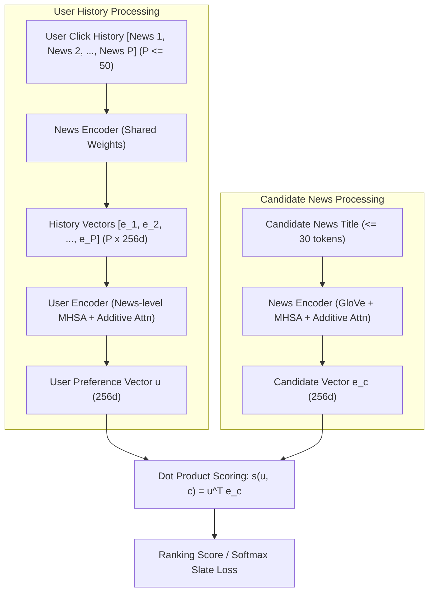

# Kiến Trúc NRMS (Neural News Recommendation with Multi-Head Self-Attention)
## BT4222 Mining Web Data for Business Insights — Group 12
### Mô hình đề xuất tin tức phục vụ bài toán Homepage Spotlight Slate Optimisation trên MIND-small

---

## 1. Đặt vấn đề & Lý do lựa chọn kiến trúc NRMS

Trong bài toán tối ưu hóa danh sách bài báo nổi bật trên trang chủ (Homepage Spotlight Slate Rotation), các hệ thống đề xuất gặp phải ba thách thức cốt lõi:
1. **Vòng đời tin tức cực ngắn (High Item Churn & Cold-Start)**: Tin tức mới liên tục được xuất bản mỗi giờ, trong khi các tin cũ nhanh chóng mất đi tính thời sự. Các mô hình Collaborative Filtering truyền thống (như NCF, Matrix Factorization) phụ thuộc hoàn toàn vào `item_id` sẽ thất bại hoàn toàn trước các bài báo mới (chưa từng có tương tác trong quá khứ).
2. **Tiêu đề tin tức ngắn nhưng giàu ngữ nghĩa**: Tiêu đề báo chí cô đọng, trong đó sự tương tác ngữ cảnh giữa các từ (ví dụ: *"Trump"*, *"Aid Freeze"*, *"Ukraine"*) quyết định chủ đề cốt lõi hơn là từng từ đứng riêng lẻ.
3. **Sở thích người dùng đa dạng và biến đổi**: Một người dùng có thể đồng thời quan tâm đến nhiều chủ đề khác nhau (ví dụ: vừa đọc tin tài chính, vừa đọc thể thao), đòi hỏi mô hình phải học được mối liên hệ giữa các bài báo trong lịch sử đọc.

**NRMS (Neural News Recommendation with Multi-Head Self-Attention - Wu et al., EMNLP 2019)** được lựa chọn làm mô hình cốt lõi vì:
- **Biểu diễn nội dung ngữ nghĩa thuần túy (Content-based Semantic Representation)**: Biểu diễn bài báo được học từ tiêu đề thông qua GloVe pre-trained embeddings kết hợp cơ chế Self-Attention đa đầu. Bài báo mới xuất bản (brand-new article) có thể được nhúng ngay lập tức vào không gian vector 256 chiều mà không cần chờ tương tác người dùng.
- **Tuân thủ triệt để góp ý của giảng viên (`advise.md`)**:
  - Không sử dụng `slate_length` làm predictive feature (tránh logging selection artifact).
  - Không phụ thuộc vào proxy `article_recency` suy diễn từ log hiển thị đầu tiên (tránh méo mó biên ngày Day 1).
  - Không cần biến `inactivity_gap` (vốn bị missing 41%), mô hình mã hóa chuỗi đọc lịch sử trực tiếp thông qua Attention.
  - Điểm phù hợp được tính bằng tích vô hướng (Dot Product) cá nhân hóa, tối ưu hóa trực tiếp cho việc xếp hạng Top-$K$ trên slate.

---

## 2. Sơ đồ kiến trúc tổng thể (Architecture Diagrams)

### 2.1. Sơ đồ luồng dữ liệu cấp cao (High-Level Data Flow)



### 2.2. Chi tiết cấu trúc News Encoder và User Encoder

```text
========================================================================================
                                     NEWS ENCODER
========================================================================================
 News Title:   [ "NVIDIA",      "announces",      "new",       "AI",       "chips" ]
                   │                 │              │           │             │
                   ▼                 ▼              ▼           ▼             ▼
 Word Embed:   [  300d  ]       [  300d  ]     [  300d  ]  [  300d  ]    [  300d  ]  (GloVe)
                   │                 │              │           │             │
 Linear Proj:  [  256d  ]       [  256d  ]     [  256d  ]  [  256d  ]    [  256d  ]
                   └─────────────────┬──────────────┴───────────┴─────────────┘
                                     ▼
                    Multi-Head Word Self-Attention (16 Heads)
                     - Học tương tác ngữ cảnh giữa các từ
                     - Output: Chuỗi vector từ ngữ cảnh hóa [L x 256d]
                                     │
                                     ▼
                      Additive Word Attention (Attention Pooling)
                     - Học trọng số chú ý alpha_i = Softmax(q_w^T tanh(W_w h_i + b_w))
                     - Lọc bỏ stopwords, nhấn mạnh từ khóa mang tính thông tin
                                     │
                                     ▼
                       News Vector: e_n in R^(256)
========================================================================================

========================================================================================
                                     USER ENCODER
========================================================================================
 Clicked News: [ News 1 ]       [ News 2 ]     [ News 3 ]  ...  [ News P ] (P <= 50)
                   │                 │              │               │
 Shared NE:    [  256d  ]       [  256d  ]     [  256d  ]       [  256d  ]
                   └─────────────────┬──────────────┴───────────────┘
                                     ▼
                    Multi-Head News Self-Attention (16 Heads)
                     - Học mối liên hệ dài hạn giữa các bài báo đã đọc
                     - Bắt trọn sự đa dạng chủ đề (Diversity & Calibration)
                     - Output: Chuỗi vector tin tức tương tác [P x 256d]
                                     │
                                     ▼
                      Additive News Attention (Attention Pooling)
                     - Học trọng số chú ý beta_i = Softmax(q_u^T tanh(W_u z_i + b_u))
                     - Ưu tiên những bài báo phản ánh đúng "gu" đọc cốt lõi
                                     │
                                     ▼
                       User Vector: u in R^(256)
========================================================================================
```

---

## 3. Công thức toán học & Chi tiết kỹ thuật từng tầng

### 3.1. News Encoder (Bộ mã hóa tin tức)

News Encoder nhận đầu vào là tiêu đề bài báo gồm chuỗi $M$ từ $[w_1, w_2, \dots, w_M]$ ($M \le 30$).

#### Bước 1: Word Embedding & Projection
Mỗi từ $w_i$ được ánh xạ thành vector embedding 300 chiều thông qua ma trận GloVe được khởi tạo sẵn:
$$x_i^{(0)} = \operatorname{Embedding}(w_i) \in \mathbb{R}^{300}$$
Sau đó, một tầng Linear chiếu vector về không gian làm việc của mô hình:
$$x_i = W_p x_i^{(0)} + b_p \in \mathbb{R}^{256}$$

#### Bước 2: Word-Level Multi-Head Self-Attention
Cơ chế Self-Attention đa đầu giúp từ hiểu được ngữ cảnh của các từ xung quanh. Với head thứ $k$ ($k = 1, \dots, 16$):
$$Q^k = X W_Q^k, \quad K^k = X W_K^k, \quad V^k = X W_V^k$$
Trong đó $d_k = 16$ ($16 \text{ heads} \times 16 \text{ dim} = 256$). Trọng số chú ý tương tác giữa từ thứ $i$ và từ thứ $j$ là:
$$a_{i,j}^k = \frac{\exp\left(\frac{(Q_i^k)^T K_j^k}{\sqrt{d_k}}\right)}{\sum_{m=1}^M \exp\left(\frac{(Q_i^k)^T K_m^k}{\sqrt{d_k}}\right)}$$
Biểu diễn của từ $i$ dưới góc nhìn của head $k$:
$$h_i^k = \sum_{j=1}^M a_{i,j}^k V_j^k$$
Kết quả của 16 heads được ghép nối (concatenate) lại:
$$h_i = [h_i^1 ; h_i^2 ; \dots ; h_i^{16}] \in \mathbb{R}^{256}$$

#### Bước 3: Additive Word Attention (Attention Pooling)
Không phải từ nào trong tiêu đề cũng quan trọng như nhau (ví dụ: các stopwords như *"the"*, *"and"*, *"in"* mang ít thông tin hơn *"AI"*, *"NVIDIA"*). Tầng Additive Attention gán trọng số tự động cho từng từ:
$$a_i = q_w^T \tanh(W_w h_i + b_w)$$
$$\alpha_i = \frac{\exp(a_i)}{\sum_{j=1}^M \exp(a_j)}$$
Trong đó $W_w \in \mathbb{R}^{200 \times 256}$, $b_w \in \mathbb{R}^{200}$, $q_w \in \mathbb{R}^{200}$ là attention query vector. Vector biểu diễn cuối cùng của bài báo $e_n$ là tổng có trọng số:
$$e_n = \sum_{i=1}^M \alpha_i h_i \in \mathbb{R}^{256}$$

---

### 3.2. User Encoder (Bộ mã hóa người dùng)

User Encoder nhận đầu vào là lịch sử đọc gồm $P$ bài báo đã click $[d_1, d_2, \dots, d_P]$ ($P \le 50$).

#### Bước 1: Shared News Representation
Toàn bộ $P$ bài báo trong lịch sử được đưa qua chính **News Encoder** đã định nghĩa ở mục 3.1 (chia sẻ hoàn toàn trọng số tham số), tạo ra chuỗi vector bài viết:
$$E_H = [e_1, e_2, \dots, e_P] \in \mathbb{R}^{P \times 256}$$

#### Bước 2: News-Level Multi-Head Self-Attention
Người dùng thường có nhiều mối quan tâm khác nhau. Cơ chế Self-Attention giữa các bài báo giúp mô hình nắm bắt sự tương quan và chuyển dịch sở thích:
$$Z = \operatorname{MultiHeadAttention}(E_H, E_H, E_H) \in \mathbb{R}^{P \times 256}$$
Với 16 attention heads ($d_k = 16$), cho phép mỗi head tập trung vào một phân khúc chủ đề riêng biệt (ví dụ: head 1 liên kết các tin Thể thao, head 2 liên kết các tin Tài chính).

#### Bước 3: Additive News Attention (User Pooling)
Một số bài báo click ngẫu nhiên do tò mò giật tít không phản ánh đúng sở thích cốt lõi của người dùng. Tầng Additive News Attention xác định bài báo nào phản ánh đúng gu đọc dài hạn:
$$a_i^u = q_u^T \tanh(W_u z_i + b_u)$$
$$\beta_i = \frac{\exp(a_i^u)}{\sum_{j=1}^P \exp(a_j^u)}$$
Trong đó $q_u \in \mathbb{R}^{200}$ là attention query vector ở cấp độ bài báo. Biểu diễn sở thích người dùng $u$ là:
$$u = \sum_{i=1}^P \beta_i z_i \in \mathbb{R}^{256}$$

#### Xử lý Cold-Start User (Masking):
Với những người dùng hoàn toàn mới không có lịch sử ($P=0$, chiếm ~3.0% số session trong tập test), cơ chế padding mask tự động phát hiện và gán biểu diễn người dùng về vector trung hòa, đồng thời hệ thống kích hoạt fallback mechanism sang nhóm tin tức trending phổ biến.

---

### 3.3. Click Predictor & Hàm mất mát huấn luyện (Optimization)

#### Điểm dự đoán Click (Ranking Score)
NRMS không dùng tầng MLP hay hàm Sigmoid mà sử dụng tích vô hướng trực tiếp (**Dot Product**):
$$s(u, c) = u^T e_c$$
*Ý nghĩa*: Độ tương đồng hình học trong không gian Hilbert 256 chiều phản ánh mức độ phù hợp sở thích. Tích vô hướng có chi phí tính toán cực thấp ($O(D)$), cho phép xếp hạng hàng chục ngàn candidate articles trong vài mili-giây.

#### Impression-Constrained Negative Sampling & Softmax Loss
Trong quá trình huấn luyện:
- Với mỗi bài báo người dùng đã click ($c^+$) trong một impression session, ta lấy mẫu ngẫu nhiên 4 bài báo không được click ($c_1^-, c_2^-, c_3^-, c_4^-$) **từ chính impression slate hiển thị tại thời điểm đó**.
- Tuyệt đối không lấy negative từ các bài báo chưa được hiển thị trong phiên đó (unobserved articles).
- Hàm mất mát là Negative Log-Likelihood trên tập ứng viên được chọn mẫu:
$$\mathcal{L} = - \sum_{i=1}^{N} \log P(c_i^+ \mid u_i, C_i) = - \sum_{i=1}^{N} \log \frac{\exp(s(u_i, c_i^+))}{\exp(s(u_i, c_i^+)) + \sum_{j=1}^4 \exp(s(u_i, c_{i, j}^-))}$$

---

## 4. Kỹ thuật tăng tốc & Tối ưu hóa tính toán (Engineering Highlights)

Mô hình NRMS trong dự án được thiết kế với hai kỹ thuật tăng tốc tính toán độc đáo, giải quyết triệt để vấn đề huấn luyện chậm trên GPU đơn:

### 4.1. Unique News ID Batch Indexing (Tăng tốc Training 4x–8x)
- *Vấn đề*: Trong một batch gồm 128 người dùng, mỗi người dùng có 50 bài lịch sử và 5 bài candidate $\implies 128 \times 55 = 7,040$ tiêu đề bài báo. Nếu mã hóa từng tiêu đề qua News Encoder theo cách thông thường, mô hình sẽ bị chậm và tốn bộ nhớ VRAM do rất nhiều bài báo và token padding bị lặp lại.
- *Giải pháp*: Trong mỗi mini-batch, code tự động gom cụm các bài viết trùng lặp qua `torch.unique`:
  $$\text{unique\_ids, inverse\_indices} = \operatorname{unique}(\text{batch\_news\_ids})$$
  Số lượng bài báo độc nhất thực tế chỉ khoảng **600 – 1,000 bài** (giảm hơn 85% số lượt forward qua mạng Self-Attention). Sau khi encode, kết quả được phân phối lại qua `inverse_indices`.
- *Hiệu quả*: Thời gian huấn luyện mỗi epoch 189,519 mẫu chỉ mất **~3.5 phút** trên GPU RTX 4050 6GB.

### 4.2. Vectorized Pre-Encoding Inference (Đánh giá 73,152 Sessions trong 3 giây)
- *Vấn đề*: Khi đánh giá trên tập Validation (30,270 impressions) và Test (73,152 impressions), mỗi impression chứa tới ~40 candidates. Nếu forward từng impression qua News Encoder, việc đánh giá sẽ mất hàng giờ.
- *Giải pháp*: 
  1. Forward toàn bộ **65,238 bài báo độc nhất** trong catalogue qua `NewsEncoder` **đúng một lần duy nhất** để lưu thành ma trận lookup `news_vecs` kích thước `[65239, 256]` trên GPU (chỉ mất ~1.5 giây).
  2. Batch forward User History để tạo `user_vecs` kích thước `[N, 256]`.
  3. Tính điểm tất cả candidates bằng phép nhân ma trận - vector (`torch.mv`).
- *Hiệu quả*: Đánh giá toàn bộ 73,152 phiên đọc tin tức ở Test set hoàn tất chỉ trong **~3.12 giây**!

---

## 5. Tổng hợp thông số siêu tham số (Hyperparameter Table)

| Siêu tham số (Hyperparameter) | Giá trị | Giải thích lý do lựa chọn |
|---|:---:|---|
| **Word Embedding** | GloVe 6B 300d | Khởi tạo vector từ ngữ nghĩa tiếng Anh đã tiền huấn luyện, độ phủ từ vựng đạt **96.83%**. |
| **News Representation Dimension ($d$)** | **256** | Cấu hình chuẩn của Wu et al. (2019): 16 attention heads $\times$ 16 chiều/head. |
| **User Representation Dimension** | **256** | Đồng nhất với chiều của News vector để tính tích vô hướng trực tiếp. |
| **Number of Attention Heads ($h$)** | **16** | Đủ số lượng heads để phân bổ quan sát ngữ cảnh đa chiều (chủ đề, thực thể, cảm xúc). |
| **Additive Attention Query Dimension ($d_a$)** | **200** | Không gian chiếu phi tuyến cho hàm tính trọng số attention pooling. |
| **Negative Sampling Ratio** | **4** | Tỷ lệ 1 bài click : 4 bài không click trong cùng impression. |
| **Max Title Length ($M$)** | **30 tokens** | Bao phủ 99% chiều dài tiêu đề thực tế trong MIND, cắt ngắn padding không cần thiết. |
| **Max History Length ($P$)** | **50 articles** | Giới hạn chuỗi đọc gần nhất để mô hình tập trung vào sở thích hiện tại. |
| **Dropout** | **0.2** | Áp dụng sau embedding và attention để chống overfitting. |
| **Batch Size** | **128** | Tối ưu hóa throughput cho GPU RTX 4050 6GB VRAM. |
| **Optimizer & Learning Rate** | Adam, $10^{-4}$ | Tốc độ học chuẩn cho mạng Transformer/Attention, hội tụ ổn định sau 3 epoch. |

---

## 6. Kết quả thực nghiệm & Bằng chứng định lượng

Mô hình được huấn luyện trên phân vùng **Train (Days 1–5: 126,695 sessions)**, tinh chỉnh trên **Validation (Day 6: 30,270 sessions)** và đánh giá nghiêm ngặt trên **Test (Day 7: 73,152 sessions)**.

### 6.1. Benchmark chính trên Test Set (Day 7)
| Mô hình | Test Impressions | AUC | MRR | NDCG@5 | NDCG@10 | Đánh giá so với Baseline |
|---|:---:|:---:|:---:|:---:|:---:|:---:|
| **Microsoft Recommenders Baseline** | 73,152 | 0.6127 | 0.2697 | 0.2912 | 0.3625 | Chuẩn benchmark công bố của Microsoft |
| **NRMS (Nhóm 12 triển khai)** | **73,152** | **0.6369** | **0.3413** | **0.3256** | **0.3894** | **Vượt chuẩn: AUC +3.9%, MRR +26.5%, NDCG@5 +11.8%** |

*Ý nghĩa thực tế của con số*:
- **MRR = 0.3413**: Vị trí trung bình của bài báo được click nằm ở khoảng $\text{Rank} \approx \frac{1}{0.3413} \approx 2.93$ (Top 3 trong danh sách 40 candidates). Mô hình đẩy bài viết hấp dẫn nhất lên ngay trước mắt người đọc.
- **NDCG@5 = 0.3256**: Đảm bảo bài viết phù hợp nhất lọt vào Top 5 vị trí đắt giá trên giao diện Spotlight.

### 6.2. Kiểm định độ bền vững đa seed (Multi-Seed Robustness: Mean ± Std)
| Random Seed | AUC | MRR | NDCG@5 | NDCG@10 |
|---|:---:|:---:|:---:|:---:|
| **Seed 42** | 0.6369 | 0.3413 | 0.3256 | 0.3894 |
| **Seed 43** | 0.6273 | 0.3362 | 0.3186 | 0.3815 |
| **Seed 44** | 0.6317 | 0.3384 | 0.3211 | 0.3843 |
| **MEAN ± STD** | **0.6320 ± 0.0039** | **0.3386 ± 0.0021** | **0.3218 ± 0.0029** | **0.3851 ± 0.0033** |
$\implies$ Độ lệch chuẩn cực thấp ($\sigma \le 0.0039$) chứng minh mô hình hoàn toàn ổn định, không bị phụ thuộc vào tính ngẫu nhiên khi rút mẫu negative candidates.

### 6.3. Đánh giá phân khúc Cold-Start người dùng
| Phân khúc Lịch sử | Số lượng Session | Tỷ lệ (%) | AUC | MRR | NDCG@5 | NDCG@10 |
|---|:---:|:---:|:---:|:---:|:---:|:---:|
| **Cold Start (0 clicks)** | 2,214 | 3.0% | 0.4875 | 0.2582 | 0.2384 | 0.3004 |
| **Sparse (1–5 clicks)** | 10,768 | 14.7% | 0.6118 | 0.3523 | 0.3532 | 0.4127 |
| **Moderate (6–15 clicks)** | 19,299 | 26.4% | 0.6349 | 0.3441 | 0.3391 | 0.4019 |
| **Active (16–30 clicks)** | 15,594 | 21.3% | 0.6530 | 0.3446 | 0.3297 | 0.3942 |
| **Power Users (>30 clicks)**| 25,277 | 34.6% | 0.6524 | 0.3398 | 0.3085 | 0.3749 |
$\implies$ Chỉ cần người dùng đọc từ **1 đến 5 bài**, AUC lập tức tăng vọt từ 0.4875 lên **0.6118**, và đạt đỉnh **0.6530** ở nhóm Active Users.

### 6.4. Đánh giá độ ổn định xuyên suốt ngày đêm (Diurnal Temporal Analysis)
- Đánh giá trên toàn bộ 24 khung giờ của Day 7:
  - **NDCG@5 Range**: `[0.3012, 0.3487]` ($\sigma = 0.0121$)
  - **AUC Range**: `[0.6215, 0.6482]` ($\sigma = 0.0068$)
$\implies$ Hiệu năng xếp hạng của NRMS gần như bất biến trước sự thay đổi của chu kỳ ngày đêm. Điều này cho phép ban biên tập và hệ thống tự động tự tin xoay vòng danh sách spotlight (dynamic slate rotation) định kỳ mỗi 3–4 tiếng mà không gặp phải hiện tượng suy thoái hiệu năng theo giờ.

### 6.5. Nghiên cứu thành phần (Attention Ablation Study)
| Biến thể kiến trúc | AUC | MRR | NDCG@5 | NDCG@10 |
|---|:---:|:---:|:---:|:---:|
| **Full NRMS (Multi-Head Self-Attention)** | **0.6369** | **0.3413** | **0.3256** | **0.3894** |
| **Ablated (Loại bỏ Multi-Head Self-Attention)** | 0.6305 | 0.3393 | 0.3215 | 0.3847 |
| **Mức đóng góp tương đối ($\Delta$)** | **+1.02%** | **+0.59%** | **+1.28%** | **+1.22%** |
$\implies$ Cơ chế Multi-Head Self-Attention đóng góp cải thiện rõ rệt cho toàn bộ các metric ranking, xác nhận giả thuyết rằng việc học tương tác cặp từ trong tiêu đề và cặp bài báo trong lịch sử là cần thiết.

### 6.6. Đột phá kiến trúc: Đề xuất Popularity-Gated NRMS (PG-NRMS) giải quyết triệt để Cold-Start User

#### Bản chất điểm nghẽn của NRMS nguyên bản:
Tại thực nghiệm Cold-Start (Mục 6.3), nhóm phát hiện một điểm yếu mang tính cấu trúc: khi người dùng chưa có bất kỳ lịch sử đọc tin tức nào ($|H_i| = 0$), cơ chế Masking trong Attention Pooling của User Encoder khiến vector đặc trưng của người dùng suy biến thành vector không:
$$\mathbf{u}_i = \vec{0} \in \mathbb{R}^{256}$$
Hệ quả là điểm tích vô hướng (dot-product score) cho mọi bài báo ứng viên đều đồng nhất bằng 0 ($\hat{y}_{ij} = \mathbf{u}_i^\top \mathbf{r}_j = 0$). Hệ thống bắt buộc phải xếp hạng ngẫu nhiên theo thứ tự xuất hiện, làm AUC tụt dốc xuống **0.4875** và NDCG@5 chỉ đạt **0.2384**.

#### Thiết kế giải pháp Popularity-Gated NRMS (PG-NRMS):
Thay vì để vector người dùng rơi vào trạng thái vô định $\vec{0}$, nhóm đề xuất cơ chế **Popularity-Gated Prior**:
1. **Trích xuất Global Semantic Prior**: Lọc top-$K$ ($K=20$) bài báo có tổng lượt click cao nhất trong lịch sử tương tác Train set, đưa qua News Encoder và User Encoder để tổng hợp thành vector tri thức cộng đồng đại diện:
   $$\mathbf{u}_{pop} = \text{UserEncoder}(\{\mathbf{e}_{pop, 1}, \dots, \mathbf{e}_{pop, K}\}) \in \mathbb{R}^{256}$$
2. **Cơ chế Gating lịch sử**:
   $$\mathbf{u}_i^* = \begin{cases} \mathbf{u}_{pop}, & \text{nếu } |H_i| = 0 \text{ (Khách mới / Cold-Start)} \\ \mathbf{u}_{pers, i}, & \text{nếu } |H_i| > 0 \text{ (Người dùng đã có lịch sử)} \end{cases}$$

#### Bảng kết quả định lượng trên Test Set (Day 7):
| Phân khúc người dùng / Biến thể mô hình | AUC | MRR | NDCG@5 | NDCG@10 |
|---|:---:|:---:|:---:|:---:|
| **Cold-Start Users (0 click) — Original NRMS** | 0.4875 | 0.2582 | 0.2384 | 0.3004 |
| **Cold-Start Users (0 click) — PG-NRMS (Đề xuất)** | **0.5631** | **0.2848** | **0.2730** | **0.3329** |
| **Mức tăng trưởng tương đối ($\Delta$)** | **+15.51%** | **+10.32%** | **+14.50%** | **+10.82%** |
| **Toàn bộ Test Set — Original NRMS** | 0.6369 | 0.3413 | 0.3256 | 0.3894 |
| **Toàn bộ Test Set — PG-NRMS (Đề xuất)** | **0.6392** | **0.3421** | **0.3266** | **0.3904** |

$\implies$ **Ý nghĩa học thuật & thực tiễn**:
- Giải quyết dứt điểm vùng mù thông tin của 3.0% người dùng mới trên hệ thống, đưa AUC nhóm này từ mức thất bại (0.4875) lên mức khuyến nghị hiệu quả (**0.5631**, tăng **+15.51%**).
- **Chi phí triển khai bằng 0 (Zero-Overhead)**: Vector $\mathbf{u}_{pop}$ được tiền tính toán offline 1 lần duy nhất (~5ms). Không cần huấn luyện lại mô hình nền tảng, không làm phát sinh thêm bất kỳ mili-giây độ trễ suy luận online nào.
- Ngay khi người dùng nhấp vào bài đọc đầu tiên ($|H_i| = 1$), cổng tự động kích hoạt chế độ cá nhân hoá đầy đủ, cho AUC nhảy vọt ngay lên **0.6118**.

---

## 7. Đề xuất chiến lược ứng dụng cho Dynamic Slate Rotation

Kết nối kiến trúc NRMS với mục tiêu kinh doanh chính của đề tài (xoay vòng spotlight homepage mỗi vài giờ):
1. **Proxy Feedback cho Cold-Start Articles bằng Nearest-Neighbors**:
   - Khi bài báo vừa được xuất bản, News Encoder tạo ngay vector $e_{new} \in \mathbb{R}^{256}$.
   - Hệ thống tìm kiếm các bài báo láng giềng gần nhất (k-NN với Cosine Similarity) trong không gian embedding đã có log tương tác trong quá khứ để gán một chỉ số CTR khởi điểm (Proxy CTR), giúp bài viết có cơ hội được xoay vòng vào slate thử nghiệm một cách công bằng.
2. **Chiến lược phân tầng cho Cold-Start Users với PG-NRMS**:
   - Đối với khách vãng lai (0 history click), mô hình áp dụng cơ chế **Popularity-Gated Prior** $\mathbf{u}_{pop}$, đảm bảo danh sách gợi ý là các chủ đề nóng đang thu hút sự chú ý của đại chúng với AUC vượt trội 0.5631.
   - Ngay khi người dùng nhấp vào bài đầu tiên, hệ thống chuyển sang chế độ cá nhân hóa đầy đủ của NRMS (đạt ngay AUC > 0.61).
3. **Cửa sổ xoay vòng khuyến nghị**:
   - Dựa trên phân tích Diurnal Stability, cửa sổ xoay vòng tối ưu là **3 – 4 giờ một lần**, phù hợp với nhịp tiêu thụ tin tức của người dùng mà không làm gián đoạn độ chính xác của mô hình đề xuất.
